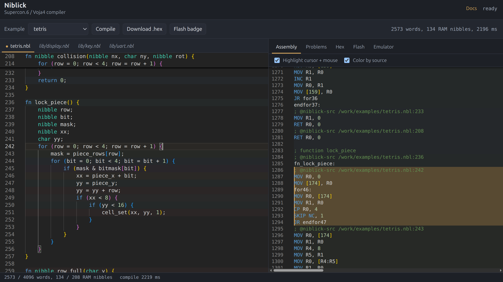

# Niblick

Niblick is a compiler for the Niblick language, a statically typed language
targeting the Hackaday Supercon.6 2022 (Voja4) badge. It emits assembly and a
`.hex` image for the badge's 12-bit instruction set and includes a headless
emulator (forked and vendored from the upstream [Supercon 6 Badge Tools](https://github.com/Hack-a-Day/2022-Supercon6-Badge-Tools/) repo)

[Open the live editor](https://furrysalamander.github.io/niblick/) |
[Read the docs](https://furrysalamander.github.io/niblick/docs/)



## Install

From PyPI:

```bash
python3 -m pip install niblick
```

From a checkout:

```bash
python3 -m venv .venv
.venv/bin/python -m pip install -e ".[dev]"
```

VS Code extension:
[furrysalamander.niblick](https://marketplace.visualstudio.com/items?itemName=furrysalamander.niblick)

## Quick start

```bash
.venv/bin/python -m niblick examples/hello.nbl --run
```

```c
import "lib/uart.nbl";

const char message[] = "Hello, Supercon!\n";

fn main() {
    uart_route(1);
    uart_init(3);
    uart_puts(message);
}
```

The compiler writes `<source>.asm` and `<source>.hex` next to the source file.

## Documentation

| Page | Contents |
|---|---|
| [Installation](https://furrysalamander.github.io/niblick/docs/getting-started/install.html) | Requirements and setup |
| [Language](https://furrysalamander.github.io/niblick/docs/language/index.html) | Syntax, types, expressions, statements, functions, structs, imports |
| [Standard library](https://furrysalamander.github.io/niblick/docs/standard-library/index.html) | Intrinsics and `lib/` modules |
| [Toolchain](https://furrysalamander.github.io/niblick/docs/toolchain/emulator.html) | CLI, emulator, diagnostics, debugger, editors |
| [Internals](https://furrysalamander.github.io/niblick/docs/internals/compiler.html) | Compiler, runtime ABI, ISA, memory map, numeric helpers |
| [Examples](https://furrysalamander.github.io/niblick/docs/examples/index.html) | Example index |
| [Project](https://furrysalamander.github.io/niblick/docs/project/repo-layout.html) | Layout, contributing, tests, release |

## License

GPL-3.0-only. See `LICENSE`.
